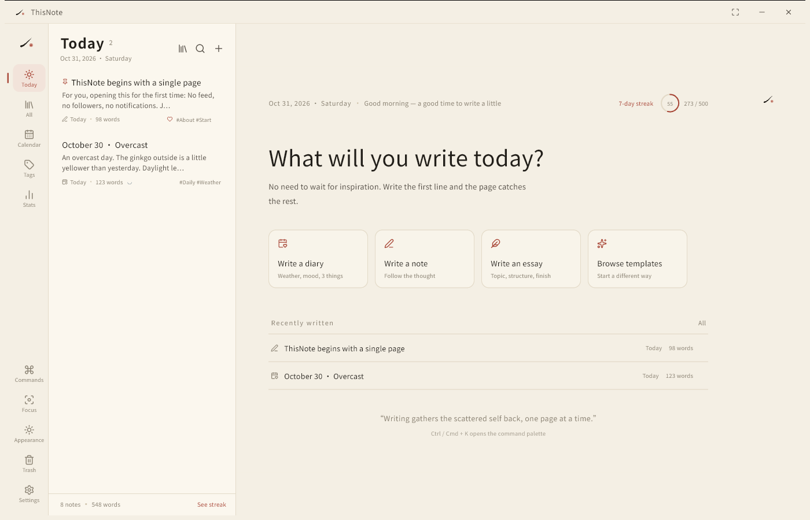
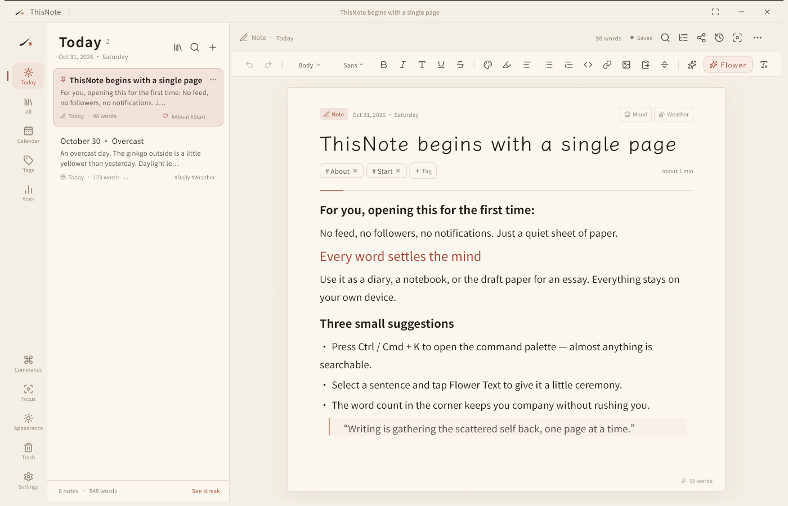
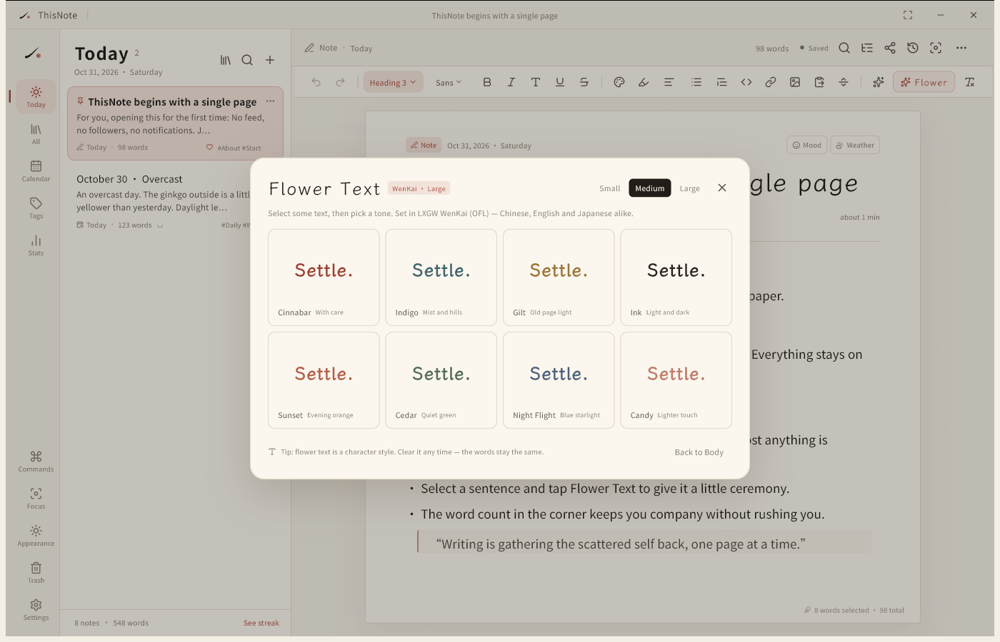
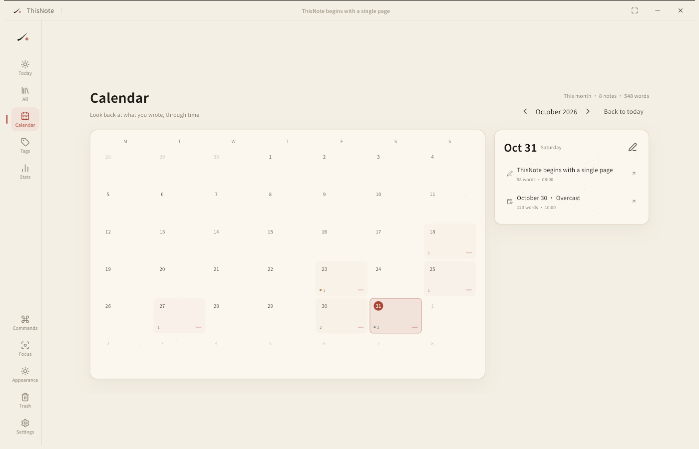
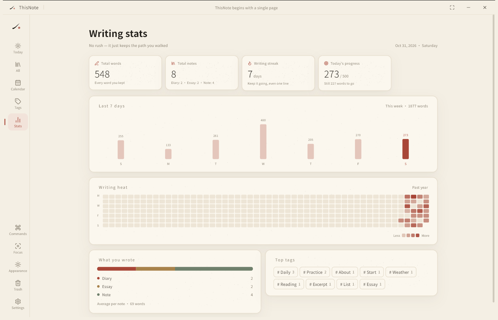
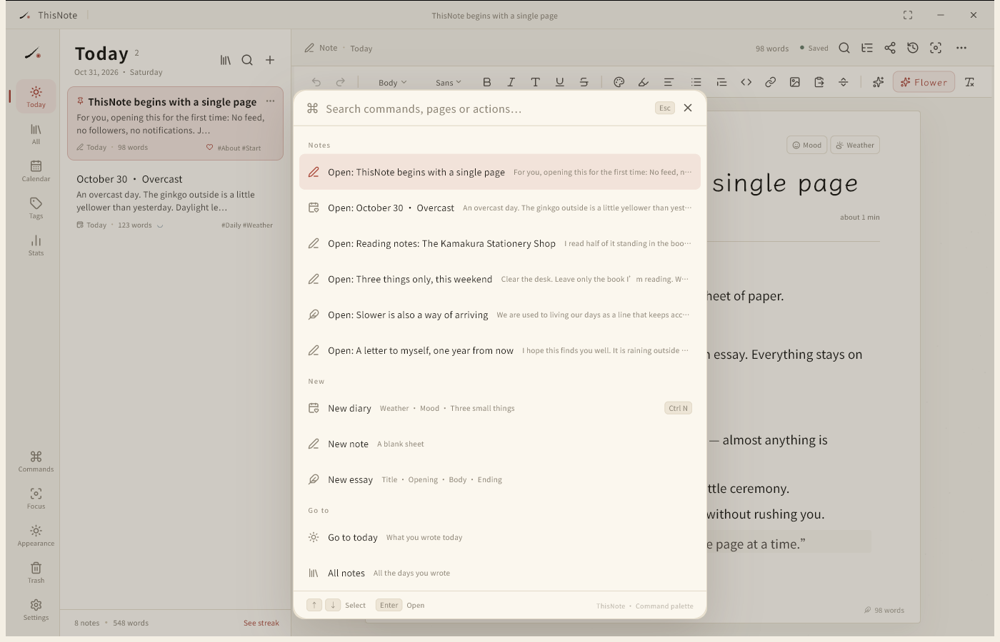
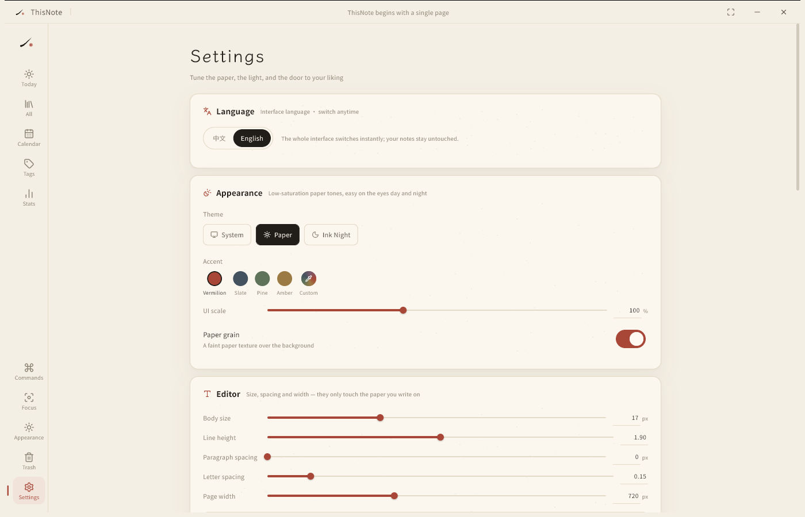
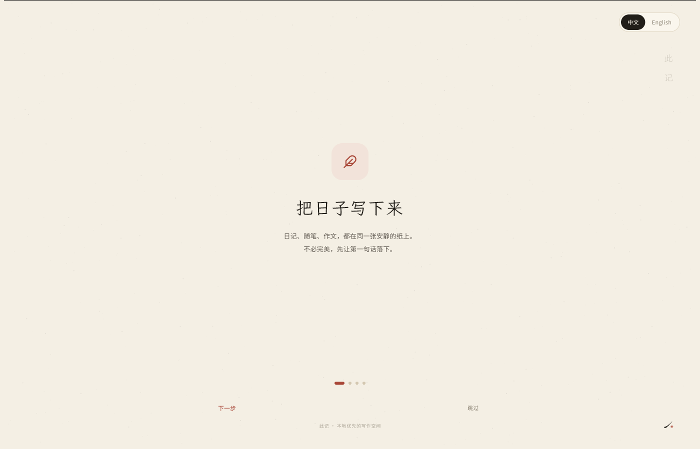
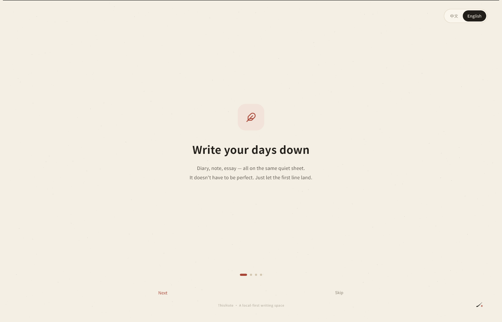

# ThisNote · 此记

> A quiet sheet of paper for diaries, notes and essays.  
> Local-first · native Windows / Android · built for writing in Chinese and English

[中文](README.md) · **English** · [GitHub](https://github.com/cookernine91263/ThisNote) · [Bilibili](https://space.bilibili.com/628622329)

ThisNote is a desktop and mobile writing space that works **entirely offline**. It brings Word-style formatting, the sense of time you get from a diary app, and a little Eastern restraint into one calm screen.



## Why ThisNote

Most note apps compete for your attention: messages, collaboration, AI pop-ups, subscription reminders.  
ThisNote goes the other way. Open it and there is paper; write and it is saved; everything stays on your machine.

The palette has only three colors: **the warm white of rice paper, the black of ink, and a single touch of vermilion**. No gradient buttons, no colorful icons, no new concepts to learn.

The interface can be switched between **中文 and English** at any time — on the first-run tour, or later in Settings. Your notes are never rewritten when you change the language.

## Features

### Writing

- Word-style rich text: bold / italic / light / underline / strikethrough / headings 1–3 / quote / code block / numbered, bulleted and to-do lists / alignment / indent / text color / highlight / links / images / dividers
- **Flower Text** (花字): select a sentence, choose one of eight typographic moods, and it becomes large WenKai type in its own color (small / medium / large)
- Find & replace (Ctrl/⌘ + F, Ctrl/⌘ + H), heading outline, selected-word count, copy as Markdown / plain text, paste as plain text
- **Tidy typography**: one tap fixes spacing between Chinese and Latin text, half-width punctuation, ellipses and redundant spaces (only the selection, when there is one)
- Click any image to set its width (25/50/75/100%), align left/center/right, replace or delete it; PDF / Word exports keep the width and alignment
- **Paste a screenshot directly**: when the clipboard holds only an image, use “Paste image” in the toolbar (some IMEs swallow Ctrl/⌘ + V, so there is an explicit button too)
- **Drag & drop**: drop images into the window to insert them; drop `.md` / `.txt` files to import them as notes
- Six bundled open-source fonts: Noto Sans SC, Noto Serif SC, LXGW WenKai, Ma Shan Zheng, ZCOOL XiaoWei and Noto Sans SC Light; switch and preview them from the toolbar
- **Import your own fonts**: pick a TTF / OTF from this machine; it is copied into the data folder and still there after a restart (this device only)
- **Writing time**: counted from actual typing, pauses longer than a minute are skipped; older notes get a conservative estimate from creation to last edit
- **Custom color wheel**: hue/lightness wheel, built-in swatches and saved colors; both text color and highlight color are yours to pick
- Auto-save, a version snapshot every five minutes (up to 40), undo / redo
- Focus mode, paper grain, dark mode, and adjustable UI scale / body size / line height / paragraph spacing / letter spacing / page width / accent color
- Light/dark switching expands as a circle from the point you clicked, without scaling the text
- Nested folders with drag-to-sort; long-press a note card to drag it into a folder or reorder notes from the same day
- Deleting a note collapses its card and offers an “Undo” at the bottom for five seconds
- Command palette (Ctrl/⌘ + K): search any note, run formatting commands, find / outline / tidy typography / export

### Diary and organization

- Three kinds — diary, note, essay — and seven starting templates
- Calendar view: month grid, writing heatmap, mood dots, “On this day”
- Mood (5) and weather (6) records
- Tags (with autocomplete from tags you have used), pin, favorite, trash (restore / delete forever)
- Folder tree (nested), drag notes between folders, manual ordering within a day
- A daily goal and a writing streak

### Stats

- Total words / notes / streak / today’s progress (animated numbers, clickable cards)
- Last 7 days as bars: click a day to see its notes and word count
- A year of writing as a heatmap: hover for the date, click a cell to revisit that day
- Breakdown by kind and top tags (click a tag to filter)

### Export and data

- **Word (.docx)**: keeps headings, bold/italic, colors, lists, quotes, images and links
- **PDF**: A4 layout with embedded Chinese, English and Japanese fonts
- **PNG long image / pages**: re-typeset as a keepsake page with four paper colors, date/tag toggles and 3× resolution; for a long piece you choose how many images to make and where each one ends (breaks can be nudged per paragraph), so social apps cannot blur it into mush
- **HTML / Markdown / TXT**
- Full zip backup (text, images, version history) with one-click restore
- **Export the whole library as a Markdown folder** (images and `assets/` included)
- **Import Markdown / plain text**: headings, bold/italic, inline code, links, lists, quotes, code blocks and dividers are preserved; you can also drop files onto the window
- WebDAV backup upload / restore (your own server or Jianguoyun)

### AI (optional, off by default)

- Any OpenAI-compatible endpoint (DeepSeek / OpenAI / a local gateway)
- Polish, expand, condense, continue, title, outline, English/Japanese translation
- **Thinking level**: Fast / Standard / Deep — you decide how much time and budget the model gets
- **One-click connection test**: sends a single word, so you instantly know whether the endpoint, model and key are right
- Friendly to reasoning models: a reasoning-only reply or a gateway that ignores SSE falls back to a non-streaming retry
- **Generate first, preview, then insert** — it never edits your draft behind your back
- Streaming output: read as it is written, stop at any time
- The API key stays on your machine; selected text is sent only when you click an AI action

### Privacy

- No account, no ads, no tracking, no cloud upload by default
- A 4-digit local passcode lock
- All data is one folder you can copy and carry away

## Interface

| Writing | Flower Text |
| --- | --- |
|  |  |

| Calendar | Stats |
| --- | --- |
|  |  |

| Command palette | Settings |
| --- | --- |
|  |  |

The first launch includes a short tour, with a language switch in the corner and a small “star it on GitHub” door on the last page (you can replay it any time from Settings → About):

| 中文 | English |
| --- | --- |
|  |  |

## Give ThisNote an echo

It does not phone home, it does not pop up, and it will never ask you to subscribe — so it really does live on you.

If it helped you write a few honest lines, leave it a ⭐ on [GitHub](https://github.com/cookernine91263/ThisNote):
(whispering: one little star would genuinely make my day ♡)

You can also find me on [Bilibili](https://space.bilibili.com/628622329) and watch this little writing space grow.
Say hi in the comments — I will answer.

> Just keep writing — that is already enough. Time will do the rest.

## Installers

Already built in this environment:

- `dist/ThisNote-Setup-1.2.0.exe` (Windows x64 installer)
- `dist/ThisNote-Android-1.2.0-arm64.apk` (Android 8.0+ arm64, signed)
- `dist/SHA256SUMS.txt`

See `dist/安装说明.txt` for installation notes.

## Tech stack

| Layer | Choice |
| --- | --- |
| Framework | Flutter 3.47.9 / Dart 3.13.7; C++ runner + Dart AOT on Windows, native embedding + Dart AOT on Android; **no WebView** |
| Editor | [flutter_quill 11.6](https://github.com/singerdmx/flutter-quill), custom toolbar, inline styles and export |
| State | provider + ChangeNotifier |
| Storage | local JSON files (atomic writes) + one file per note + history snapshots; no database dependency |
| Export | `pdf`, `archive` (OOXML zip), `xml`; DOCX / PDF built in-house |
| Desktop | `window_manager` frameless window with a custom title bar |
| Fonts | Noto Sans SC (Light/Regular/Bold), Noto Serif SC, LXGW WenKai, Ma Shan Zheng, ZCOOL XiaoWei |
| Icons | Lucide Icons |
| Build | Windows: MSVC 2022 + Windows 11 SDK; Android: JDK 17 + Android SDK 36 + Gradle 9.3.1 |

### Layout

```
app/
  lib/
    main.dart                    startup, window, providers
    src/
      app.dart                   MaterialApp / theme / first-run gate
      core/                      design tokens, motion, formatting, i18n
      data/                      models, file store, templates and seed content
      state/app_state.dart       app state + editing session
      features/                  pages and editor
      services/                  export, AI, WebDAV
  assets/fonts/                  bundled fonts (OFL)
  test/                          tests for word count, export and editor
installer/                       Inno Setup script
tools/                           font prep, icon generation, screenshots
```

## Build

### Requirements

- Flutter 3.47.9+ (Dart 3.13.7)
- Windows: Visual Studio 2022 Build Tools (Desktop development with C++, Windows 11 SDK, CMake)
- Android: JDK 17, Android SDK Platform 36 / Build-Tools 36
- Installer: Inno Setup 6

### Windows

```powershell
cd app
flutter pub get
flutter build windows --release
# output: build/windows/x64/runner/Release/this_note.exe
```

Installer:

```powershell
& "$env:LOCALAPPDATA\Programs\Inno Setup 6\ISCC.exe" ..\installer\ThisNote.iss
# output: dist/ThisNote-Setup-1.2.0.exe
```

### Android

Prepare `android/key.properties`:

```properties
storePassword=...
keyPassword=...
keyAlias=thisnote
storeFile=thisnote-release.jks
```

```powershell
cd app
flutter build apk --release --target-platform android-arm64
# output: build/app/outputs/flutter-apk/app-release.apk (arm64)
```

### Tests

```powershell
flutter test
```

## Where your data lives

- Windows: `%APPDATA%\ThisNote\data`
- Android: `ThisNote/` inside the app's private directory

```
data/
  library.json        index of notes
  settings.json       settings
  activity.json       words actually written each day
  notes/              one file per note (Quill Delta + plain text)
  history/            version snapshots
  assets/             inserted images
```

Copy the whole `data/` folder to move everything. A zip backup can also be created in Settings.

## Shortcuts

> If your IME intercepts a combination, every action is also available from the toolbar, the sidebar and the command palette.

| Shortcut | Action |
| --- | --- |
| `Ctrl/⌘ + K` | Command palette |
| `Ctrl/⌘ + N` | New note |
| `Ctrl/⌘ + S` | Save now |
| `Ctrl/⌘ + F` | Find |
| `Ctrl/⌘ + H` | Find & replace |
| `Ctrl/⌘ + Shift + V` | Paste as plain text |
| `Ctrl/⌘ + B` | Bold |
| `Ctrl/⌘ + I` | Italic |
| `Ctrl/⌘ + U` | Underline |
| `Ctrl/⌘ + Shift + F` | Focus mode |
| `Ctrl/⌘ + ,` | Settings |

## Design notes

Colors, typography, motion and interaction conventions are documented in [docs/DESIGN.md](docs/DESIGN.md).

## Acknowledgements

This project stands on the shoulders of many open-source projects:

- [flutter_quill](https://github.com/singerdmx/flutter-quill): editor core, Delta document model and extensible style hooks
- [AppFlowy](https://github.com/AppFlowy-IO/AppFlowy): block editor, command palette and the “local-first” product feel
- [Memos](https://github.com/usememos/memos): lightweight capture, heatmaps and low-friction input
- [Day One](https://dayoneapp.com/): calendar, mood and “On This Day” diary experience (commercial, reference only)
- [iA Writer](https://ia.net/writer): focus mode and typographic restraint
- [Typora](https://typora.io/): the what-you-see-is-what-you-get writing feel
- [Lucide](https://lucide.dev/): icons
- [Noto Sans SC](https://fonts.google.com/noto/specimen/Noto+Sans+SC) and [LXGW WenKai](https://github.com/lxgw/LxgwWenKai): fonts

ThisNote does not copy code from the projects above; it only borrows product structure and interaction ideas. The editor and export implementations are built on flutter_quill and its public API.

## License

Code is released under [MIT](LICENSE). Bundled fonts are under the SIL Open Font License 1.1; see [THIRD_PARTY_NOTICES.md](THIRD_PARTY_NOTICES.md).
