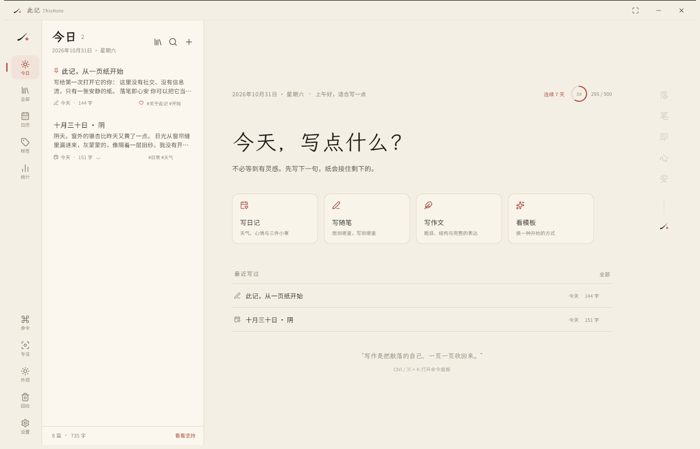
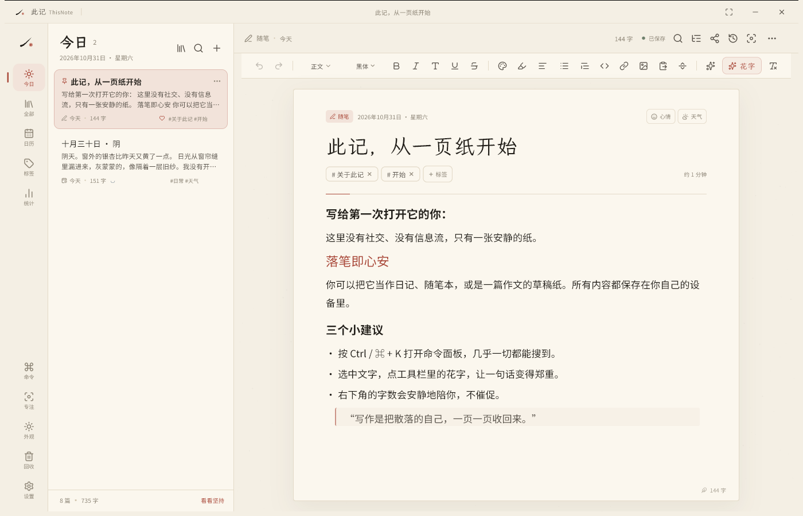
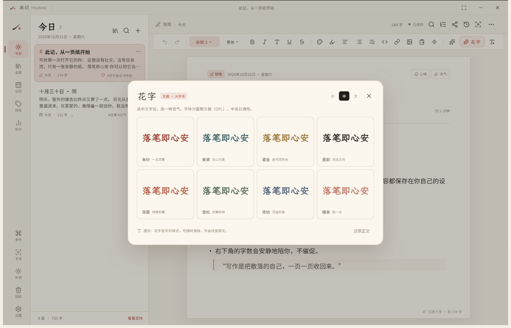
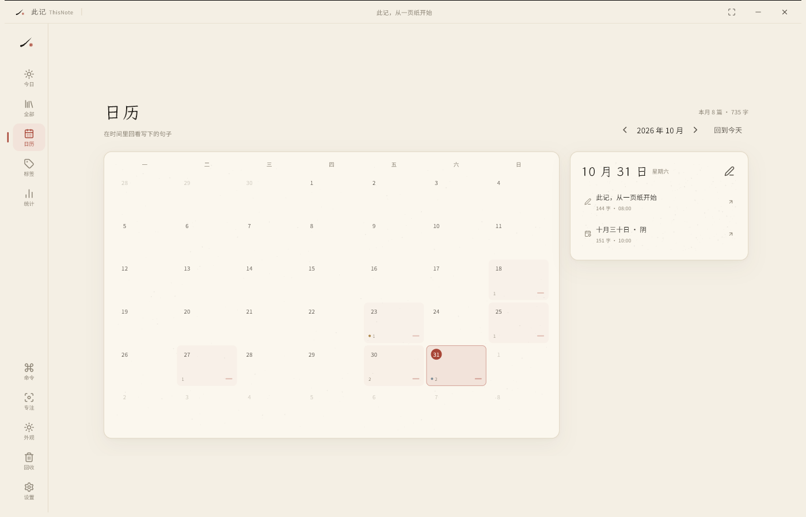
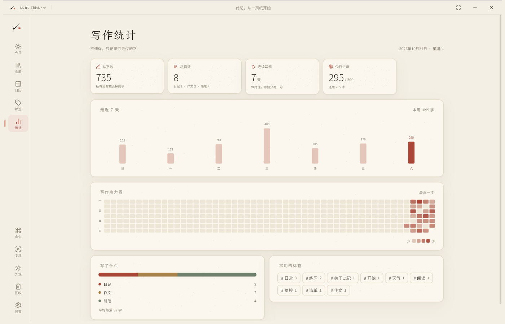
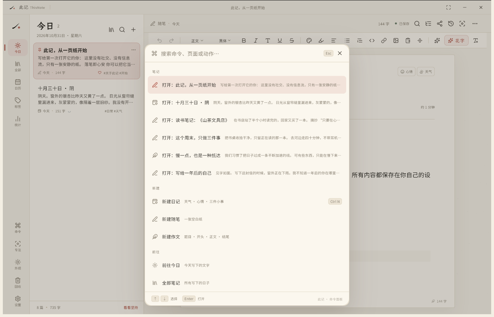
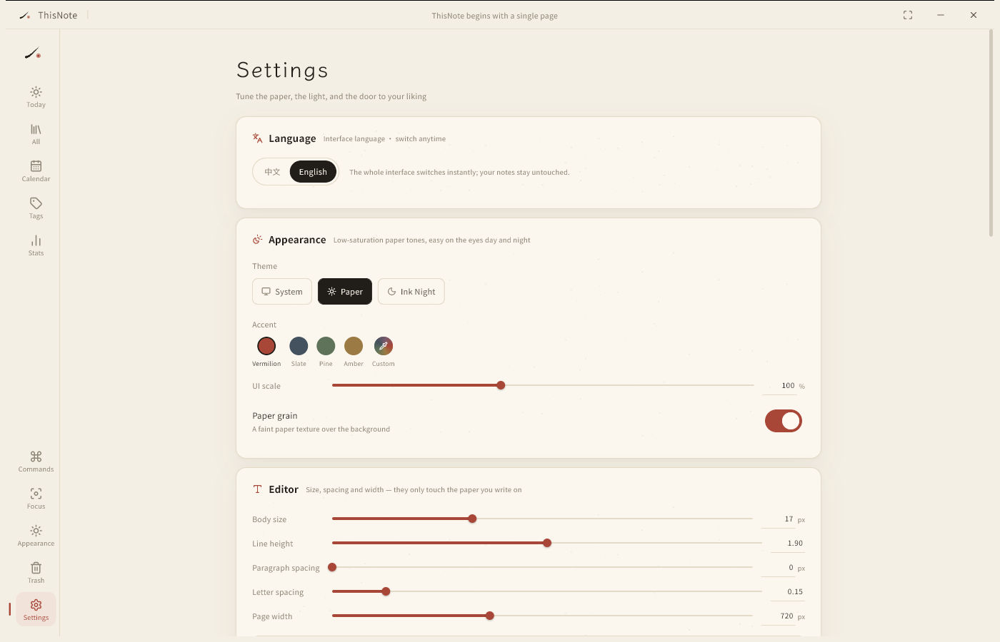
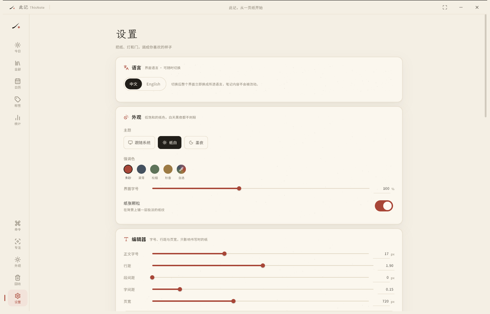
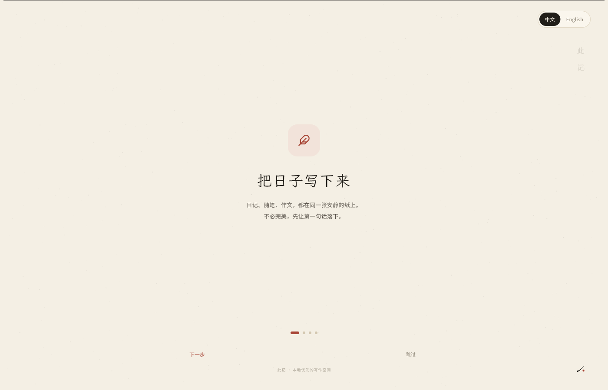
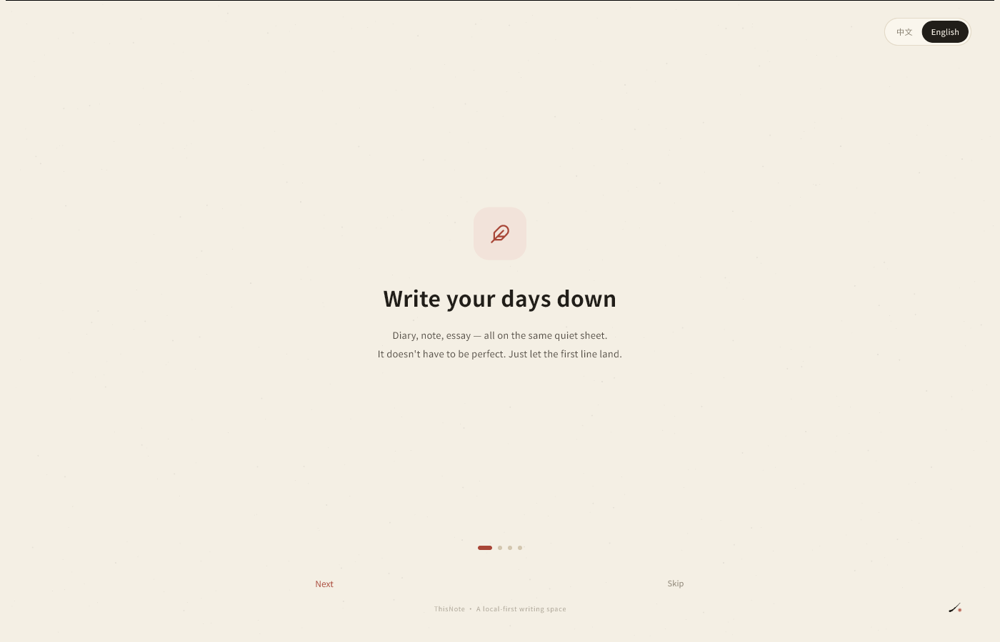

# 此记 · ThisNote

> 一张安静的纸，装得下日记、随笔和作文。  
> 本地优先 · 原生 Windows / Android · 中文书写体验优先

**中文** · [English](README.en.md)

「此记」是一个**不联网也能好好写字**的桌面与移动写作空间。它把 Word 式的排版能力、日记应用的时间感、以及一点点东方的留白，收进同一个界面里。界面支持**中文 / English** 随时切换，首次启动的引导页就能直接选。



## 为什么是「此记」

很多笔记软件在争夺你的注意力：消息、协作、AI 弹窗、订阅提醒。  
「此记」反其道而行——打开就是纸，写完就保存，所有内容留在本机。

设计上只保留三种颜色：**宣纸的暖白、墨的黑、朱砂的一点红**。没有渐变按钮，没有彩色图标，没有需要学习的新概念。

## 功能

### 写作

- **中文 / English 界面**：引导页与设置里都能切换，切换后立即生效，笔记内容不会被改写
- Word 式富文本：加粗 / 倾斜 / 变细 / 下划线 / 删除线 / 标题 1–3 / 引用 / 代码块 / 有序、无序、待办列表 / 对齐 / 缩进 / 文字颜色 / 高亮 / 链接 / 图片 / 分隔线
- **一键花字**：选中一句话，从 8 种花字气质中选择，立刻变为大字号文楷 + 专属颜色（小 / 中 / 大三档）
- 查找替换（Ctrl/⌘ + F、Ctrl/⌘ + H）、标题大纲、选中字数、复制为 Markdown / 纯文本、粘贴为纯文本
- **整理排版**：一键处理中英文之间的空格、半角标点、省略号与多余空格（有选区只整理选区）
- 图片点开即可调宽度（25/50/75/100%）、左中右对齐、替换或删除；PDF / Word 导出会保留宽度与对齐
- **截图直接粘贴**：剪贴板里只有图片时，点工具栏「粘贴图片」即可落到光标处（部分输入法会拦截 Ctrl/⌘ + V，所以保留了一个明确的按钮入口）
- **拖拽**：把图片拖进窗口就插入当前笔记；把 `.md` / `.txt` 拖进来会直接导入成新笔记
- 内置 6 种开源字体：思源黑体、思源宋体、霞鹜文楷、马善政毛笔、站酷小薇、思源细体；工具栏可直接切换并实时预览
- **自定义色盘**：色相/明度轮盘、内置色、常用色收藏；文字色与高亮色都可自选
- 自动保存、5 分钟自动版本快照（最多 40 个）、撤销 / 重做
- 专注模式、纸纹、深色模式、界面字号 / 正文字号 / 行距 / 段间距 / 字间距 / 页宽 / 强调色可调；数值可直接填写，大整数自动吸附
- 深/浅色切换从点击位置圆形扩散，文字不缩放
- 侧边栏「滑入 / 平滑」二选一；首次引导里也能选
- 文件夹可嵌套、可拖拽排序；长按笔记卡片即可拖动，拖进文件夹、同日笔记可调顺序
- 删除笔记时卡片快速收起，底部出现「撤销」，五秒内都能恢复
- 命令面板（Ctrl/⌘ + K）：搜任一篇笔记、执行格式命令、查找 / 目录 / 整理排版 / 导出

### 日记与整理

- 日记 / 随笔 / 作文三种体裁，以及 7 种起始模板
- 日历视图：月历、写作热力、心情圆点、「那年今日」
- 心情（5 种）与天气（6 种）记录
- 标签（输入时自动补全写过的标签）、置顶、收藏、回收站（可恢复 / 永久删除）
- 文件夹树（可嵌套）、笔记拖拽归类、同日笔记手动排序
- 今日目标、连续写作天数

### 统计

- 总字数 / 总篇数 / 连续天数 / 今日进度（数字滚动，卡片可点击）
- 最近 7 天柱状图：点任意一天看当天篇目与字数
- 最近一年写作热力图：悬停看日期，点格子回看当天
- 体裁分布、高频标签（标签可点击进入筛选）

### 导出与数据

- **Word (.docx)**：保留标题、粗斜体、颜色、列表、引用、图片与链接
- **PDF**：A4 版式，嵌入中英日字体
- **PNG 长图**：重新排版成可收藏的纸页，提供 4 种纸色、日期/标签开关，按 3× 分辨率导出
- **HTML / Markdown / TXT**
- 完整备份 zip（正文、图片、历史版本），一键恢复
- **整库导出为 Markdown 文件夹**（图片与 `assets/` 一起带走）
- **导入 Markdown / 纯文本**：标题、粗斜体、行内代码、链接、列表、引用、代码块、分隔线都会保留；也可以直接把文件拖进窗口
- WebDAV 备份上传 / 恢复（自己的服务器或坚果云）

### AI（可选，默认关闭）

- 任意 OpenAI 兼容接口（DeepSeek / OpenAI / 本地网关均可）
- 润色、扩写、压缩、续写、起标题、生成提纲、英/日翻译
- **先生成、后预览、再写入**，不会偷偷改你的稿子
- 流式输出：边生成边读，随时可以「停止」
- API Key 只存在本机；只有点击 AI 动作时才发送选中文字

### 隐私

- 无账号、无广告、无追踪、无云端默认上传
- 4 位本地密码锁
- 所有数据是一个可以自己拷走的文件夹

## 界面

| 写作 | 花字 |
| --- | --- |
|  |  |

| 日历 | 统计 |
| --- | --- |
|  |  |

| 命令面板 | English 界面 |
| --- | --- |
|  |  |



首次启动会有一页简短的引导，右上角可以直接切换语言：

| 中文引导 | English 引导 |
| --- | --- |
|  |  |

## 安装包

当前环境已生成：

- `dist/ThisNote-Setup-1.0.0.exe`（Windows x64 安装包）
- `dist/ThisNote-Android-1.0.0.apk`（Android 8.0+，已签名）
- `dist/SHA256SUMS.txt`

安装说明见 `dist/安装说明.txt`。

## 技术栈

| 层 | 选择 |
| --- | --- |
| 框架 | Flutter 3.47.9 / Dart 3.13.7，Windows 使用 C++ runner + Dart AOT，Android 使用原生 embedding + Dart AOT；**没有 WebView** |
| 编辑器 | [flutter_quill 11.6](https://github.com/singerdmx/flutter-quill)，自定义工具栏、行内样式与导出 |
| 状态 | provider + ChangeNotifier |
| 存储 | 本地 JSON 文件（原子写入）+ 每篇独立文件 + 历史快照目录；无数据库依赖 |
| 导出 | `pdf`、`archive`（OOXML zip）、`xml`，自行构建 DOCX / PDF |
| 桌面 | `window_manager` 无边框窗口、自绘标题栏 |
| 字体 | Noto Sans SC（Light/Regular/Bold）、Noto Serif SC、LXGW WenKai、Ma Shan Zheng、ZCOOL XiaoWei |
| 图标 | Lucide Icons |
| 构建 | Windows：MSVC 2022 + Windows 11 SDK；Android：JDK 17 + Android SDK 36 + Gradle 9.3.1 |

### 目录

```
app/
  lib/
    main.dart                    启动、窗口、Provider
    src/
      app.dart                   MaterialApp / 主题 / 首屏门禁
      core/                      设计令牌、动效、格式化、中英文案、通用组件
      data/                      模型、文件仓库、模板与种子内容
      state/app_state.dart       应用状态 + 编辑会话
      features/                  页面与编辑器
      services/                  导出、AI、WebDAV
  assets/fonts/                  内置字体（OFL）
  test/                          字数和导出测试
installer/                       Inno Setup 安装包脚本
tools/                           字体准备、图标生成脚本
```

## 构建

### 依赖

- Flutter 3.47.9+（Dart 3.13.7）
- Windows：Visual Studio 2022 Build Tools（Desktop development with C++、Windows 11 SDK、CMake）
- Android：JDK 17、Android SDK Platform 36 / Build-Tools 36
- 安装包：Inno Setup 6

### Windows

```powershell
cd app
flutter pub get
flutter build windows --release
# 产物：build/windows/x64/runner/Release/this_note.exe
```

安装包：

```powershell
& "$env:LOCALAPPDATA\Programs\Inno Setup 6\ISCC.exe" ..\installer\ThisNote.iss
# 产物：dist/ThisNote-Setup-1.0.0.exe
```

### Android

准备签名文件 `android/key.properties`：

```properties
storePassword=...
keyPassword=...
keyAlias=thisnote
storeFile=thisnote-release.jks
```

```powershell
cd app
flutter build apk --release
# 产物：build/app/outputs/flutter-apk/app-release.apk
```

### 测试

```powershell
flutter test
```

## 数据位置

- Windows：`%APPDATA%\ThisNote\data`
- Android：应用私有目录下的 `ThisNote/`

结构：

```
data/
  library.json        列表索引
  settings.json       设置
  activity.json       每日实际写作字数（续写旧稿也算今天）
  notes/              每篇正文（Quill Delta + 纯文本）
  history/            历史快照
  assets/             插入的图片
```

直接复制整个 `data/` 文件夹即可迁移。设置里也可以生成 zip 备份。

## 快捷键

> 若系统输入法拦截了组合键，界面内所有功能都可以通过工具栏、侧栏与命令面板完成。

| 快捷键 | 动作 |
| --- | --- |
| `Ctrl/⌘ + K` | 命令面板 |
| `Ctrl/⌘ + N` | 新建随笔 |
| `Ctrl/⌘ + S` | 立即保存 |
| `Ctrl/⌘ + F` | 查找 |
| `Ctrl/⌘ + H` | 查找替换 |
| `Ctrl/⌘ + Shift + V` | 粘贴为纯文本 |
| `Ctrl/⌘ + B` | 加粗 |
| `Ctrl/⌘ + I` | 倾斜 |
| `Ctrl/⌘ + U` | 下划线 |
| `Ctrl/⌘ + Shift + F` | 专注模式 |
| `Ctrl/⌘ + ,` | 设置 |

## 设计说明

配色、排版、动效与交互约定见 [docs/DESIGN.md](docs/DESIGN.md)。

## 参考与致谢

这个项目站在许多开源项目的肩膀上：

- [flutter_quill](https://github.com/singerdmx/flutter-quill)：编辑器内核、Delta 文档模型与可扩展的样式钩子
- [AppFlowy](https://github.com/AppFlowy-IO/AppFlowy)：块编辑器、命令面板与「本地优先」的产品气质
- [Memos](https://github.com/usememos/memos)：轻量记录、热力图与低摩擦输入
- [Day One](https://dayoneapp.com/)：日历、心情、On This Day 的日记体验（商业产品，仅作体验参考）
- [iA Writer](https://ia.net/writer)：专注模式与排版克制
- [Typora](https://typora.io/)：所见即所得的写作手感
- [Lucide](https://lucide.dev/)：图标
- [Noto Sans SC](https://fonts.google.com/noto/specimen/Noto+Sans+SC) 与 [LXGW WenKai](https://github.com/lxgw/LxgwWenKai)：字体

「此记」没有复制上述项目的代码，只在产品结构与交互上做了借鉴；编辑器与导出实现基于 flutter_quill 及其公开 API。

## 许可证

代码以 [MIT](LICENSE) 发布。内置字体为 SIL Open Font License 1.1，详见 [THIRD_PARTY_NOTICES.md](THIRD_PARTY_NOTICES.md)。

